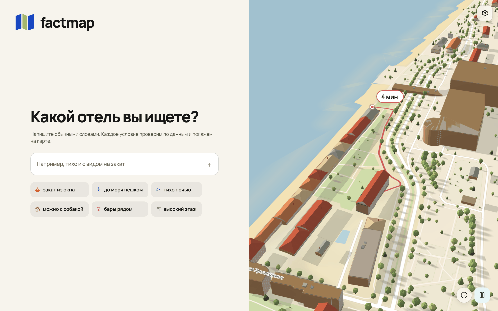
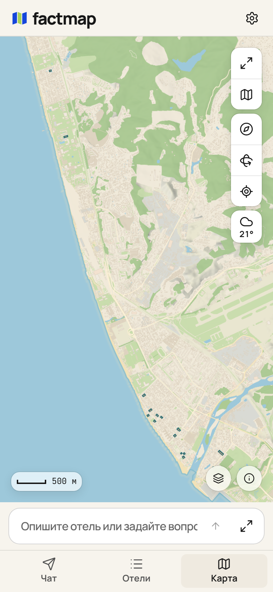
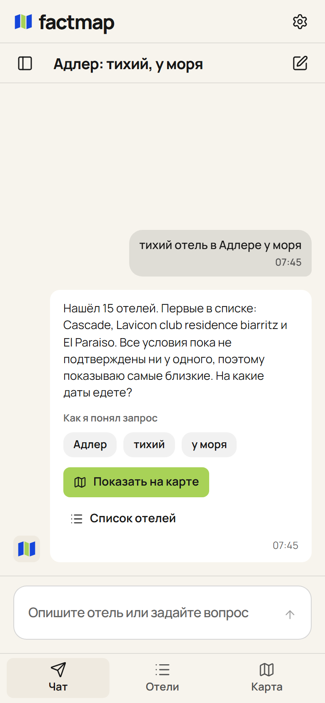
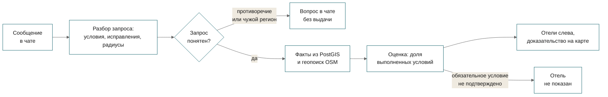

<p align="center">
  <picture>
    <source media="(prefers-color-scheme: dark)" srcset="docs/readme/banner.dark.png">
    
  </picture>
</p>

<p align="center">
  Путешественник описывает отель в чате своими словами и получает отели Сочи, где у каждого
  пожелания есть подтверждающий факт с источником или пометка «нет данных».
</p>

<p align="center">
  <!-- readme:buttons -->
  <a href="#запуск"><picture><source media="(prefers-color-scheme: dark)" srcset="docs/readme/cta-run.dark.png"></picture></a>
  <a href="docs/for-jury.md"><picture><source media="(prefers-color-scheme: dark)" srcset="docs/readme/cta-jury.dark.png"></picture></a>
  <a href="docs/README.md"><picture><source media="(prefers-color-scheme: dark)" srcset="docs/readme/cta-docs.dark.png"></picture></a>
  <!-- /readme:buttons -->
</p>

<p align="center">
  <!-- readme:status -->
  <a href="#результаты"><picture><source media="(prefers-color-scheme: dark)" srcset="docs/readme/badge-status-1.dark.png"></picture></a>
  <a href="#запуск"><picture><source media="(prefers-color-scheme: dark)" srcset="docs/readme/badge-status-2.dark.png"></picture></a>
  <br>
  <a href="docs/evidence.md#проверка-предложений-по-датам-25-октября-2026"><picture><source media="(prefers-color-scheme: dark)" srcset="docs/readme/badge-status-3.dark.png"></picture></a>
  <picture><source media="(prefers-color-scheme: dark)" srcset="docs/readme/badge-status-4.dark.png"></picture>
  <a href="LICENSE"><picture><source media="(prefers-color-scheme: dark)" srcset="docs/readme/badge-status-5.dark.png"></picture></a>
  <!-- /readme:status -->
</p>

<p align="center">
  <!-- readme:stack -->
  <picture><source media="(prefers-color-scheme: dark)" srcset="docs/readme/badge-stack-1.dark.png"></picture>
  <picture><source media="(prefers-color-scheme: dark)" srcset="docs/readme/badge-stack-2.dark.png"></picture>
  <br>
  <picture><source media="(prefers-color-scheme: dark)" srcset="docs/readme/badge-stack-3.dark.png"></picture>
  <picture><source media="(prefers-color-scheme: dark)" srcset="docs/readme/badge-stack-4.dark.png"></picture>
  <br>
  <picture><source media="(prefers-color-scheme: dark)" srcset="docs/readme/badge-stack-5.dark.png"></picture>
  <picture><source media="(prefers-color-scheme: dark)" srcset="docs/readme/badge-stack-6.dark.png"></picture>
  <!-- /readme:stack -->
</p>

<p align="center">
  <!-- readme:nav -->
  <a href="#зачем-это"><picture><source media="(prefers-color-scheme: dark)" srcset="docs/readme/badge-nav-1.dark.png"></picture></a>
  <a href="#как-это-работает"><picture><source media="(prefers-color-scheme: dark)" srcset="docs/readme/badge-nav-2.dark.png"></picture></a>
  <a href="#попробовать-за-две-минуты"><picture><source media="(prefers-color-scheme: dark)" srcset="docs/readme/badge-nav-3.dark.png"></picture></a>
  <br>
  <a href="#результаты"><picture><source media="(prefers-color-scheme: dark)" srcset="docs/readme/badge-nav-4.dark.png"></picture></a>
  <a href="#запуск"><picture><source media="(prefers-color-scheme: dark)" srcset="docs/readme/badge-nav-5.dark.png"></picture></a>
  <a href="#устройство"><picture><source media="(prefers-color-scheme: dark)" srcset="docs/readme/badge-nav-6.dark.png"></picture></a>
  <a href="#ограничения"><picture><source media="(prefers-color-scheme: dark)" srcset="docs/readme/badge-nav-7.dark.png"></picture></a>
  <!-- /readme:nav -->
</p>

<p align="center">
  
  <br>
  <sub>Локальный стенд 2026-10-28, запрос разобран языковой моделью, срез OSM Сочи, окно 1440 px. Запрос в чате вернул 18 отелей; у Cascade до моря 0,2 минуты пешком (10 м).</sub>
</p>

<p align="center">
  
  
  
  <br>
  <sub>Тот же стенд 2026-10-28. Главная показывает город у «Космоса» в Адлере, телефон снят в ширине 390 px.</sub>
</p>

> **Значение факта никогда не приходит от языковой модели.** Модель только раскладывает запрос на
> условия: у порта `LLMPort` нет метода, который вернул бы значение характеристики, а условие с
> характеристикой не из реестра отбрасывается (`test_an_invented_characteristic_is_dropped`).
> Значение даёт георасчёт, тег OSM или отельер, и карточка показывает его источник и уверенность.

## Зачем это

Путешественник пишет: «тихий отель с видом на закат недалеко от моря». В фильтрах сайта бронирования
таких полей нет, а «рядом с морем» в описании отеля не говорит, сколько идти пешком и куда выходят
окна. Ответ лежит вокруг отеля: в радиусе 350 м от «Островка» в Сочи стоит 512 зданий, и этажность
в OpenStreetMap указана только у 161 из них ([доказательства](docs/evidence.md#проверка-диалога-и-сцены-25-октября-2026)).

Factmap разбирает ту же фразу на три условия и проверяет каждое по данным. У «Островка» **до моря
3,7 минуты пешком по графу улиц OSM, тихая сторона здания подходит с оговоркой, а закат виден не
отовсюду: солнце в апреле — августе садится по азимуту 284–303°, и горизонт открывается только
с определённого этажа**. Маршрут до берега виден на карте. Неизвестное условие опускает отель в
списке, но совпадением не считается.

Название составлено из fact и map: каждый показанный факт об отеле лежит на карте вместе с
источником.

## Как это работает



<table>
<tr>
<td valign="top" width="33%">

**1. Неизвестное не равно «не подходит»**

Если факта нет, вес условия остаётся в знаменателе, а в числитель идёт ноль: отель опускается, но
не исчезает. Факт с оговоркой вроде «с 5-го этажа» засчитывается частично. Обязательное условие без
факта убирает отель из выдачи.

<sub>`test_an_unknown_property_lowers_the_score_without_removing_the_hotel` и соседние тесты в `backend/tests/unit/domain/test_scoring.py`</sub>

</td>
<td valign="top" width="33%">

**2. Объекты рядом ищутся в момент запроса**

Модель возвращает тег OSM, радиус и дословный фрагмент запроса, PostGIS ищет объекты при каждом
поиске. Заранее посчитанных полей вида «бары рядом» нет, поэтому «зоопарк в 10 км» и «аптека в
километре» работают без правки кода.

<sub>`test_a_nearby_place_request_is_kept_as_tool_input`; запросы 3–12 из [результатов](#результаты)</sub>

</td>
<td valign="top" width="33%">

**3. Противоречие получает вопрос, а не выдачу**

Если модель находит противоречие или город вне загруженного региона, поиск не запускается. Чат
отвечает «Уточните условия: в запросе есть противоречие» или «Данные по региону «…» пока не
загружены». Это работает только с живой моделью.

<sub>Запросы 19–21 из [результатов](#результаты); юнит-теста нет</sub>

</td>
</tr>
</table>

## Попробовать за две минуты

После [запуска](#запуск) откройте http://localhost:8080. Входа нет, ключи не нужны.

| | Что сделать | Что увидите |
|---|---|---|
| 1 | Напишите в чате справа «тихий отель с видом на закат недалеко от моря» | Ответ «Показываю 20 отелей», понятые пожелания «тихий», «видом на закат», «недалеко от моря» и строку «Не нашёл в данных: отель»; слева 20 отелей |
| 2 | Выберите «Островок» и нажмите значок карты у строки «До моря пешком: 3,7 мин» | Карточка: закат «Нет подтверждённых данных», тихая сторона «Подходит с условиями»; на карте линия маршрута до берега, в фактах «Географический расчёт» и уверенность 0,80 |
| 3 | Нажмите «Новый поиск» и напишите «отель, где можно с собакой» | «Пока не нашёл отелей с подтверждённым совпадением», список пуст: политики размещения с животными нет ни у одного отеля |

Полный маршрут и что доказывает каждый шаг описаны в [маршруте для жюри](docs/for-jury.md).

## Результаты

22 запроса, записанные до прогона, отправлены по одному разу в `POST /api/v1/search` живого стенда
с DeepSeek V4.1 Flash и PostGIS 2026-10-25 ([разбор каждого запроса](docs/evidence.md#проверка-22-запросов-на-живом-стенде-2026-10-25)).
Базовой линии и порогов у этого прогона нет, поэтому сравнения с базой тоже нет.

| Метрика | Factmap | Чего число не показывает |
|---|---|---|
| Ответов без ошибки | **22 из 22** | Смысловую точность разбора |
| Запросов с выдачей | **16 из 22** | Что показанные отели подходят; шесть пустых выдач ожидались |
| Медиана времени ответа | **3,79 с** | Работу под нагрузкой: запросы шли по одному, время включает сеть модели |
| Максимум времени ответа | **8,69 с** | Гарантию времени ответа |

Шесть пустых выдач приходятся на вид на закат и собаку (подтверждённых данных нет), два
противоречия, Казань вне тогдашнего загруженного региона и космодром, которого нет в радиусе 2 км.

**Где проигрываем.** Точность подбора не измерена: ни одна выдача не сверена с разметкой. Вид на
закат не рассчитывается, поэтому в главном запросе это условие у всех отелей неизвестно. Без ключа
модели офлайн-разбор понимает только фразы реестра и явно названное Сочи; произвольные города
требуют живой модели.

<details>
<summary><b>Повторить запрос из набора</b></summary>
<br>

```bash
curl -s http://localhost:8000/api/v1/search \
  -H 'content-type: application/json' \
  -d '{"query": "хочу отель рядом с зоопарком в радиусе 10 км", "region_id": "sochi", "limit": 20}'
```

Числа раздела получены с живой моделью: в `.env` нужны `LLM_PROVIDER=openai_compat`,
`LLM_BASE_URL`, `LLM_API_KEY` и `LLM_MODEL`. С офлайн-разбором ответы будут другими.

<!-- scrub:start -->
Весь набор: `python3 work/evals/run_search_22.py`, сырые ответы пишутся в
`work/evals/search-22-results.json`. Перед сдачей набор и скрипт нужно перенести из `work/`,
иначе после вычистки команда пропадёт.
<!-- scrub:end -->

</details>

## Запуск

```bash
make up
make seed && make precompute
```

Интерфейс откроется на http://localhost:8080, Swagger бэкенда на http://localhost:8000/docs.
`.env` не обязателен: без него работает офлайн-разбор запросов, а карта, рельеф и демо-данные берутся
из репозитория. Сеть нужна для сборки образов и прогноза погоды. `make seed` и `make precompute`
запускаются на хосте и требуют [uv](https://docs.astral.sh/uv/).

<details>
<summary><b>Разработка, проверки, переменные</b></summary>
<br>

```bash
make api
cd frontend && npm ci --silent && npm run dev
```

Проверки: `make check` для бэкенда (Ruff, mypy, import-linter, unit и контрактные тесты) и
`cd frontend && npm run verify`. Живая модель включается переменными `LLM_*` в `.env`; полный список
переменных, порты и разбор сбоев есть в [запуске и проверках](docs/running.md).

</details>

## Устройство

Стенд состоит из четырёх сервисов Compose: PostGIS 3.4, одноразовые миграции dbmate, бэкенд FastAPI
со слоями `domain`, `application`, `adapters`, `interfaces` и фронтенд на React с картой MapLibre.
Совпадение отеля с запросом считает `backend/src/hotel_agent/domain/services/scoring.py` по фактам из
базы и геопоиску PostGIS, а модель в этой точке ничего не решает.

| Документ | Что внутри |
|---|---|
| [API](docs/api.md) | Диалог, карточка отеля с номерами, цены на даты, коды ошибок; полная форма в [OpenAPI](docs/api/openapi.yaml) |
| [ADR 0001](docs/adr/0001-postgis-raw-sql.md) | Почему PostGIS и сырой SQL через psycopg 3 |
| [ADR 0002](docs/adr/0002-layers-inside-backend.md) | Почему слои лежат внутри `backend/` |
| [ADR 0003](docs/adr/0003-yandex-openai-compatible-endpoint.md) | Живая модель через OpenAI-совместимый endpoint Yandex Cloud |
| [Знак и логотип](docs/brand/README.md) | Исходники знака Factmap в SVG |

## Ограничения

- **У кабинета отельера нет части интерфейса.** На бэкенде работают очередь вопросов, свободный
  ответ с раскладкой по полям и цитатой, подтверждение и исправление факта, сводка кабинета и
  лента оповещений. Экрана для сводки и оповещений в интерфейсе пока нет, и входа тоже нет:
  ответить может любой, кто открыл страницу.
- **Точность подбора не измерена.** Прогон 22 запросов дал 16 непустых выдач, но ни одну из них не
  сверяли с разметкой. Вид на закат не рассчитывается, номеров в срезе нет (0 записей). Цены и
  свободные номера на даты приходят от поставщика ETG только с ключом; без него карточка отеля
  пишет, что проверка не подключена.
- **Без ключа понятны только фразы реестра.** Офлайн-разбор знает фразы семи характеристик и
  явно названное Сочи. Живой поиск опирается на 33 233 отеля России и уточняет город, если
  пользователь его не назвал; для большинства этих отелей номера и цены не подтверждены.

Все ограничения со статусом и тем, что закрыло бы каждое, собраны в [ограничениях](docs/limitations.md).

<!-- scrub:start -->
## Для команды

Этот блок вырезается при сдаче вместе с маркерами `scrub:start` и `scrub:end`.

1. `bash .claude/scripts/setup.sh` — один раз на клон: хуки коммитов и ссылки на общий каталог `skills/` для Claude Code и Codex.
   Все скилы лежат в `skills/`; `.claude/skills/<имя>` и `.agents/skills/<имя>` ссылаются на одни
   и те же исходники. После добавления или удаления скила — `bash .claude/scripts/sync-agents.sh`.
2. Материалы организаторов — в `brief/sources/`, затем скил `hack-kickoff`: `brief/` и `context/`, шапка
   `AGENTS.md`, тезис и P0-сценарий. Сейчас `brief/` пуст: ТЗ, критерии и название хакатона не заведены,
   поэтому в README нет карты требований и подписи команды.
3. Визуал README — в стиле сайта: `cd frontend && npm run tokens:export -- --out ../presentation/readme/tokens.css`,
   затем `cd presentation && npm run readme` пересобирает `docs/readme/*.png` из `presentation/readme/assets.html`
   и красит mermaid-диаграммы цветами продукта. Шрифт Manrope для картинок лежит в `presentation/readme/fonts/`.
   Бейджи shields.io не используются.
4. Этот README ведёт скил `readme`: рабочая версия во время хакатона, продуктовая к сдаче.
   Маршрут жюри и карта требований — `jury-route`, документация — `docs-writing`, сдача — `submission`.

Перед защитой: `bash .claude/scripts/strip-ai.sh` показывает на копии, что будет удалено, какие
следы останутся и что не так в истории коммитов. `--apply` удаляет файлы агентов и внутренние
доки (список в `.claude/scrub-paths`), `--apply --history` ещё и переписывает всю историю: только
заголовки, без соавторов и агентов. Перед изменениями скрипт сохраняет бэкап.
<!-- scrub:end -->

<p align="center">
  <picture><source media="(prefers-color-scheme: dark)" srcset="docs/readme/mark.dark.png"></picture>
  <br>
  <sub>Factmap, 2026. Карта: © участники OpenStreetMap, ODbL. Рельеф: Copernicus GLO-30, © DLR e.V. 2010–2014 и © Airbus Defence and Space GmbH 2014–2018, предоставлено по программе Copernicus Европейским союзом и ESA.</sub>
</p>
