<p align="center">
  <picture>
    <source media="(prefers-color-scheme: dark)" srcset="docs/readme/banner.dark.png">
    
  </picture>
</p>

<p align="center">
  {{Кто пользователь и что у него меняется, одной строкой. Не повторяет обещание с баннера: называет
  человека, его задачу и результат его словами.}}
</p>

<p align="center">
  <!-- readme:buttons -->
  <a href="https://{{DOMAIN}}"><picture><source media="(prefers-color-scheme: dark)" srcset="docs/readme/cta-live.dark.png"></picture></a>
  <a href="#запуск"><picture><source media="(prefers-color-scheme: dark)" srcset="docs/readme/cta-run.dark.png"></picture></a>
  <a href="docs/README.md"><picture><source media="(prefers-color-scheme: dark)" srcset="docs/readme/cta-docs.dark.png">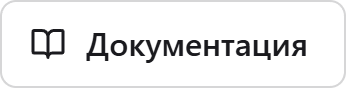</picture></a>
  <!-- /readme:buttons -->
</p>

<p align="center">
  <!-- readme:status -->
  <a href="#результаты"><picture><source media="(prefers-color-scheme: dark)" srcset="docs/readme/badge-status-1.dark.png"></picture></a>
  <a href="#запуск"><picture><source media="(prefers-color-scheme: dark)" srcset="docs/readme/badge-status-2.dark.png">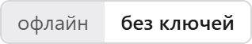</picture></a>
  <br>
  <a href="docs/running.md"><picture><source media="(prefers-color-scheme: dark)" srcset="docs/readme/badge-status-3.dark.png">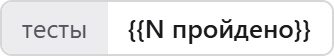</picture></a>
  <picture><source media="(prefers-color-scheme: dark)" srcset="docs/readme/badge-status-4.dark.png">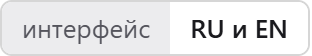</picture>
  <a href="LICENSE"><picture><source media="(prefers-color-scheme: dark)" srcset="docs/readme/badge-status-5.dark.png"></picture></a>
  <!-- /readme:status -->
</p>

<p align="center">
  <!-- readme:stack -->
  <picture><source media="(prefers-color-scheme: dark)" srcset="docs/readme/badge-stack-1.dark.png">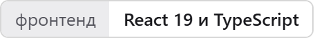</picture>
  <picture><source media="(prefers-color-scheme: dark)" srcset="docs/readme/badge-stack-2.dark.png">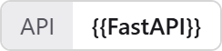</picture>
  <picture><source media="(prefers-color-scheme: dark)" srcset="docs/readme/badge-stack-3.dark.png">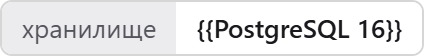</picture>
  <br>
  <picture><source media="(prefers-color-scheme: dark)" srcset="docs/readme/badge-stack-4.dark.png">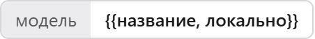</picture>
  <picture><source media="(prefers-color-scheme: dark)" srcset="docs/readme/badge-stack-5.dark.png">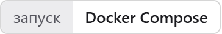</picture>
  <!-- /readme:stack -->
</p>

<p align="center">
  <!-- readme:nav -->
  <a href="#зачем-это"><picture><source media="(prefers-color-scheme: dark)" srcset="docs/readme/badge-nav-1.dark.png">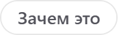</picture></a>
  <a href="#как-это-работает"><picture><source media="(prefers-color-scheme: dark)" srcset="docs/readme/badge-nav-2.dark.png"></picture></a>
  <a href="#попробовать-за-две-минуты"><picture><source media="(prefers-color-scheme: dark)" srcset="docs/readme/badge-nav-3.dark.png">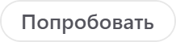</picture></a>
  <br>
  <a href="#результаты"><picture><source media="(prefers-color-scheme: dark)" srcset="docs/readme/badge-nav-4.dark.png"></picture></a>
  <a href="#запуск"><picture><source media="(prefers-color-scheme: dark)" srcset="docs/readme/badge-nav-5.dark.png">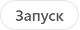</picture></a>
  <a href="#устройство"><picture><source media="(prefers-color-scheme: dark)" srcset="docs/readme/badge-nav-6.dark.png"></picture></a>
  <a href="#ограничения"><picture><source media="(prefers-color-scheme: dark)" srcset="docs/readme/badge-nav-7.dark.png"></picture></a>
  <!-- /readme:nav -->
</p>

<p align="center">
  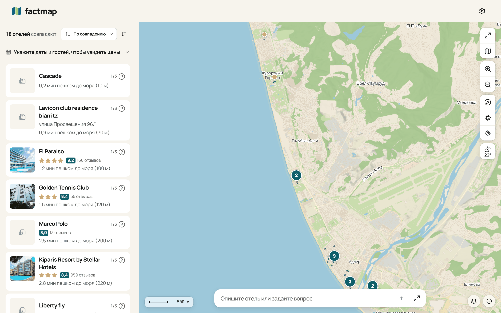
  <br>
  <sub>{{Реальный прогон на демо-данных: что ввели, что система сделала, что видно в кадре.}}</sub>
</p>

> **{{Главное правило продукта одной фразой.}}** {{Чем оно закреплено в коде и что гарантирует
> пользователю. Правило сформулировано так, чтобы его нарушение можно было поймать.}}

## Зачем это

{{Как задачу решают сейчас и где это ломается: конкретный случай, одно число с источником в
[доказательствах](docs/evidence.md).}}

{{Что меняет продукт, на том же сквозном примере: что вводит пользователь, что делает система, что он
получает. Три предложения, ключевое жирным.}}

Название — {{происхождение одной фразой: какую механику оно называет}}.

## Как это работает

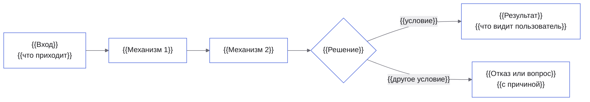

<table>
<tr>
<td valign="top" width="33%">

**{{1. Механизм как утверждение}}**

{{Как устроен и почему без него не работает, два-три предложения.}}

<sub>{{Чем проверено: тест, метрика или шаг маршрута, со ссылкой}}</sub>

</td>
<td valign="top" width="33%">

**{{2. Механизм как утверждение}}**

{{Как устроен и почему важен.}}

<sub>{{Чем проверено}}</sub>

</td>
<td valign="top" width="33%">

**{{3. Механизм как утверждение}}**

{{Как устроен и почему важен.}}

<sub>{{Чем проверено}}</sub>

</td>
</tr>
</table>

## Попробовать за две минуты

На [стенде](https://{{DOMAIN}}) или после [запуска](#запуск). Демо-учётка: `{{login}}` / `{{password}}`.

| | Что сделать | Что увидите |
|---|---|---|
| 1 | {{Адрес и действие}} | {{Наблюдаемый результат: текст, число, состояние}} |
| 2 | {{Действие, на котором видно главное правило}} | {{Результат}} |
| 3 | {{Действие, которое система не даёт сделать}} | {{Отказ и его причина на экране}} |

Полный маршрут, что доказывает каждый шаг и где ответ на каждый критерий оценки — в
[маршруте для жюри](docs/for-jury.md). Каждое требование ТЗ по пунктам — в
[карте требований](docs/requirements-map.md).

## Результаты

{{Метод одной фразой: на каких данных, сколько объектов, откуда они.}} План с метриками и порогами
зафиксирован до первого прогона — [план валидации](docs/validation-plan.md).

| Метрика | {{PRODUCT}} | База | Порог |
|---|---|---|---|
| {{M1. Метрика}} | **{{значение}}** | {{значение}}, {{что за база}} | {{≥ X}} |
| {{M2. Метрика}} | **{{значение}}** | {{значение}}, {{что за база}} | {{≤ X}} |
| {{M3. Цена решения}} | **{{значение}}** | {{значение}} | {{≤ X}} |

**Где проигрываем.** {{Метрика, по которой база лучше или порог не взят, с числом и причиной.}}

<details>
<summary><b>Пересчитать все числа раздела</b></summary>
<br>

```bash
{{команда, которая пересобирает отчёт}}
```

{{Время прогона и машина. Без сети и платных ключей; отчёт пишется в `{{путь}}`.}}

</details>

## Запуск

```bash
cp .env.example .env
docker buildx bake
docker compose up
```

Интерфейс шаблона — http://localhost:8080, Swagger бэкенда — http://localhost:8000/docs.
У бэкенда пока один метод — `GET /api/v1/health`; сценарии, база и засев данных появятся при реализации
проекта. Сборка образов требует сети.

<details>
<summary><b>Разработка, проверки, переменные</b></summary>
<br>

```bash
cd frontend && npm ci --silent && npm run dev
```

Проверки: `cd frontend && npm run verify`; бэкенд — `cd backend && uv run ruff check . && uv run mypy . && uv run pytest tests/unit`. Переменные окружения,
демо-учётки, тесты и деплой — в [запуске и проверках](docs/running.md).

</details>

## Устройство

{{Два предложения: из каких частей собран стенд и в какой точке принимается ключевое решение
продукта.}}

| Документ | Что внутри |
|---|---|
| [Архитектура](docs/architecture.md) | Роли, части стенда, путь данных основного сценария, что заменяется без правки кода |
| [API](docs/api.md) | Вход и права, формат ошибок, методы; OpenAPI генерируется из кода |
| [Зависимости](docs/dependencies.md) | Компоненты, библиотеки и модели с версиями и лицензиями |
| [Глоссарий](docs/glossary.md) | Термины предметной области, одно понятие — одно слово |
| [Оглавление](docs/README.md) | Все страницы и где ответ на каждый пункт ТЗ о документации |

## Ограничения

- **{{Самое сильное ограничение как утверждение.}}** {{Что именно не доказано или не работает, с числом,
  и что смягчает.}}
- **{{На каких данных всё проверено.}}** {{Синтетика или реальные данные, сколько, чего они не
  покрывают.}}
- **{{Что упрощено.}}** {{Границы логики, синтетические данные и детерминированный запасной вариант, если они используются.}}

Все ограничения, со статусом и тем, что закрыло бы каждое, — в [ограничениях](docs/limitations.md).

<!-- scrub:start -->
## Для команды

Этот блок вырезается при сдаче вместе с маркерами `scrub:start` и `scrub:end`.

1. `bash .claude/scripts/setup.sh` — один раз на клон: хуки коммитов и ссылки на общий каталог `skills/` для Claude Code и Codex.
   Все скилы лежат в `skills/`; `.claude/skills/<имя>` и `.agents/skills/<имя>` ссылаются на одни
   и те же исходники. После добавления или удаления скила — `bash .claude/scripts/sync-agents.sh`.
2. Материалы организаторов — в `brief/sources/`, затем скил `hack-kickoff`: `brief/` и `context/`, шапка
   `AGENTS.md`, тезис и P0-сценарий.
3. Название и знак — скилы `naming` и `brand-identity`.
4. Визуал README — в стиле сайта: `cd frontend && npm run tokens:export`, затем
   `cd presentation && npm run readme` пересобирает `docs/readme/*.png` из `presentation/readme/assets.html`
   и красит mermaid-диаграммы цветами продукта. Бейджи shields.io не используются.
5. Этот README ведёт скил `readme`: рабочая версия во время хакатона, продуктовая к сдаче.
   Маршрут жюри и карта требований — `jury-route`, документация — `docs-writing`, сдача — `submission`.

Международный хакатон: README, `docs/`, ассеты и слайды по-английски, заголовки и якоря переводятся
вместе.

Перед защитой: `bash .claude/scripts/strip-ai.sh` показывает на копии, что будет удалено, какие
следы останутся и что не так в истории коммитов. `--apply` удаляет файлы агентов и внутренние
доки (список в `.claude/scrub-paths`), `--apply --history` ещё и переписывает всю историю: только
заголовки, без соавторов и агентов. Перед изменениями скрипт сохраняет бэкап.
<!-- scrub:end -->

<p align="center">
  <picture><source media="(prefers-color-scheme: dark)" srcset="docs/readme/mark.dark.png"></picture>
  <br>
  <sub>Команда {{TEAM}}, {{HACKATHON}}, {{YEAR}}.</sub>
</p>
