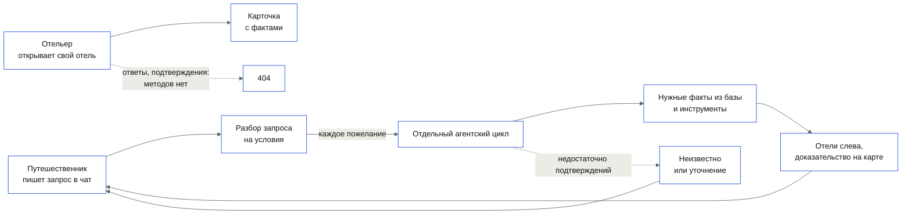
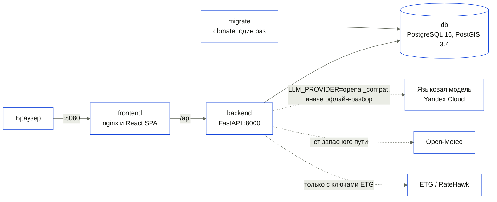

# Архитектура

> Factmap состоит из четырёх сервисов Compose: база PostgreSQL 16 с PostGIS 3.4, одноразовые
> миграции dbmate, бэкенд FastAPI и фронтенд React, который раздаёт nginx. Языковая модель
> разбирает запрос и выбирает инструменты исследования данных; совпадения рассчитывает код
> по фактам, записям базы и географическим измерениям. Без ключей и без сети основной сценарий проходит на
> офлайн-разборе `LLM_PROVIDER=fake`, а карта, рельеф и демо-данные лежат в репозитории.

**Читайте, если** вы проверяете техническую проработку или добавляете код · **Связано:**
[API](api.md) · [зависимости](dependencies.md) · [запуск](running.md) ·
[объяснения решений](design-decisions.md)

---

## Кто что делает в системе?



| Роль | Что делает | Где проверяются права |
|---|---|---|
| Путешественник | Пишет запрос и уточнения в чат, выбирает отель, открывает доказательство условия на карте, выбирает даты для предложений | Нигде: входа нет, диалог открывается по UUID |
| Отельер | Видит карточку своего отеля с фактами и источниками; ответить, подтвердить или исправить факт не может, методов на бэкенде нет | Нигде: страница открывается по адресу |
| Система | Разбирает запрос, ищет объекты рядом, оценивает совпадение, рассчитывает факты из среза при `make precompute` | `backend/src/hotel_agent/domain/services/`, `application/use_cases/` |

Прав доступа нет ни на бэкенде, ни на фронтенде; это записано в
[ограничениях](limitations.md#нет-входа-и-прав-доступа).

## Из каких частей собран стенд?



| Контейнер | Образ | Роль |
|---|---|---|
| `db` | `imresamu/postgis:16-3.4` | Отели, здания, улицы, пешеходный граф, берег, пляжи, POI, факты, диалоги, связи с каталогом ETG; том `db-data` |
| `migrate` | `ghcr.io/amacneil/dbmate:2.36.0` | Применяет SQL из `backend/migrations/postgres/` и завершается; бэкенд стартует только после её успеха |
| `backend` | `python:3.12.15-slim`, зависимости ставит `uv` 0.11.33 | API и сценарии; проверка здоровья `GET /api/v1/health`; `characteristics/` и `data/` смонтированы только для чтения |
| `frontend` | `node:22-alpine` для сборки, `nginx:1.27-alpine` для раздачи | Раздача SPA и прокси `/api/` на `API_UPSTREAM` с таймаутом 900 с |

Все порты привязаны к `127.0.0.1`: 8080 фронтенд, 8000 бэкенд, 5432 база. Сессий и паролей
пользователей нет. Состояние живёт только в PostgreSQL: процесс бэкенда держит пул соединений и
загруженный реестр характеристик, история диалогов переживает перезапуск вместе с томом `db-data`.
Загрузка среза и расчёт фактов идут не через Compose, а командами `make seed` и `make precompute` с
хоста ([запуск](running.md)).

## Как проходит основной сценарий?

```mermaid
%%{init: {"theme":"base","themeVariables":{"primaryColor":"#ffffff","primaryTextColor":"#12140f","primaryBorderColor":"#1546db","secondaryColor":"#eaece5","tertiaryColor":"#f4f5f1","lineColor":"#61665a","textColor":"#12140f","noteBkgColor":"#eaece5","noteTextColor":"#4a4e44","actorBkg":"#ffffff","actorBorder":"#1546db","fontFamily":"Manrope Variable"}}}%%
sequenceDiagram
    actor U as Путешественник
    participant FE as frontend
    participant BE as backend
    participant LLM as Модель или офлайн-разбор
    participant DB as db
    U->>FE: сообщение в чате
    FE->>BE: POST /api/v1/chat/messages
    BE->>LLM: сообщение, история, поисковые условия, выбранная карточка
    LLM-->>BE: consult, hotel или search
    alt консультация или вопрос о выбранном отеле
        BE->>DB: сохранить сообщения, прежний запрос и снимок
        BE-->>FE: ответ, прежняя выдача и её search_message_id
    else явное поисковое намерение
        BE->>LLM: разбор актуального поискового запроса
        LLM-->>BE: условия, объекты рядом, город/регион
        alt нужны уточнения
            BE-->>FE: вопрос в чате
        else запрос понятен
            BE->>DB: кандидаты и исходные документы
            BE->>LLM: выбор инструментов и проверяемые условия
            BE->>DB: факты и географические проверки
            DB-->>BE: факты и найденные объекты
            BE->>BE: score по каждому отелю
            BE->>DB: сообщения и снимок выдачи
            BE-->>FE: история, условия, до 20 отелей
        end
    end
    FE-->>U: ответ; при поиске — подборка и доказательства
    Note over BE,LLM: ошибка маршрутизации даёт уточнение без поиска; ошибки поискового этапа обрабатываются отдельно
```

Ключевое решение принимает `score()` в `backend/src/hotel_agent/domain/services/scoring.py`: доля
выполненных условий, взвешенная по весу условия и уверенности факта. Факт берётся из базы, а для
объекта рядом создаётся в момент запроса из результата `ST_DWithin`
(`backend/src/hotel_agent/adapters/db/nearby_objects.py`). Если факта нет, совпадение
`unknown`: вес остаётся в знаменателе, отель опускается, но не исчезает. Обязательное условие
убирает отель только при подтверждённом несоответствии; отсутствие факта оставляет частичное
совпадение. Нарушение этих правил роняет тесты
`backend/tests/unit/domain/test_scoring.py`, например
`test_an_unknown_property_lowers_the_score_without_removing_the_hotel` и
`test_a_required_property_that_is_unknown_keeps_a_partial_recommendation`. Модель в этой точке ничего не
решает: условие с характеристикой не из реестра или со значением не того типа отбрасывается до
оценки (`test_an_invented_characteristic_is_dropped`,
`test_model_invents_no_unmentioned_or_wrongly_typed_intents`).

## Как устроен бэкенд?

```text
backend/
  src/hotel_agent/domain/        сущности, условия запроса, оценка, уверенность, конфликты источников
  src/hotel_agent/application/   сценарии в use_cases/ и порты в ports/
  src/hotel_agent/adapters/      PostgreSQL и PostGIS, модель, ETG, Open-Meteo, DEM, OSM, реестр YAML
  src/hotel_agent/interfaces/    роутеры и схемы FastAPI, команды CLI
  src/hotel_agent/composition.py выбор реализаций портов по настройкам
  src/hotel_agent/main.py        сборка приложения FastAPI
  migrations/postgres/           SQL-миграции dbmate
  tests/                         unit, contract, integration
```

| Слой | Что в нём | Чего ему нельзя |
|---|---|---|
| `domain` | `Fact`, `Intent`, `Characteristic`, `scoring`, `confidence`, `conflict_resolver` | Импортировать `application`, `adapters`, `interfaces` и `fastapi`, `pydantic`, `starlette`, `psycopg`, `yaml`, `httpx`, `anthropic`, `openai` |
| `application` | Сценарии (`SearchHotels`, `Chat`, `GetHotelOffers` и другие) и порты (`LLMPort`, `HotelOffersPort`, `WeatherPort`) | Импортировать `adapters`, `interfaces` и те же фреймворки |
| `adapters`, `interfaces` | Реализации портов, HTTP и CLI | Импортировать `main`, `composition`, `settings` |

Направление зависимостей проверяют `uv run lint-imports` по контрактам в `backend/pyproject.toml` и
независимо `backend/tests/unit/architecture/test_dependency_rule.py`. Почему слои лежат в
`backend/`, объясняет [ADR 0002](adr/0002-layers-inside-backend.md), почему SQL без ORM,
[ADR 0001](adr/0001-postgis-raw-sql.md).

## Как проверяется пожелание без готовой характеристики?

`DataExplorer` получает непроверенные фрагменты запроса и реальные сведения о заполненности
данных. Модель выбирает следующий инструмент, читает наблюдения и формирует проверку по
полученным полям. Значения свойств отеля вычисляются инструментами. Условия со ссылкой на
несуществующее поле отклоняются и остаются непроверенными.

| Инструмент | Какие данные возвращает |
|---|---|
| `inspect_data` | Поля, заполненность и примеры записей отелей, номеров и услуг |
| `find_hotels` | Объекты в выбранном радиусе около города с проверкой границы страны |
| `read_records` | Совпадения по фильтрам над фактическими полями инвентаризации и исходными текстами |
| `search_documents` | Семантически близкие фрагменты со ссылкой на источник; при широком поиске также новые кандидаты |
| `measure_terrain` | Высоту земли и перепад высот по девяти точкам вокруг каждого отеля |
| `measure_geometry` | Расстояния до береговой линии по прямой и точки для карты |

Область может расширяться до 50 км; в расчёте не более 500 отелей. Контур страны взят из
[Natural Earth 1:10m](https://www.naturalearthdata.com/downloads/10m-cultural-vectors/10m-admin-0-countries/).
Модель задаёт числовые критерии для пожелания, например выбирает высоту и перепад рельефа.
Код применяет их ко всем измеренным отелям и формирует факты с измерениями, порогами и
ссылками карты. Производная оценка помечается частичным подтверждением. Высота земли
не доказывает этаж номера или вид из окна.

Для каждого пожелания выполняется отдельный цикл: до 32 шагов и 180 секунд, до 600 секунд
на весь поиск. Лимит сообщает о незавершённой проверке. [Инструменты и состояния](wish-agent.md). Если следующий вызов модели недоступен,
сохраняется уже проверенный по инструментам результат. Другие источники проверяются по смыслу
пожелания; уточнение по одному условию сохраняет совпадения по остальным. Мягкие предпочтения допускают
частичную выдачу; вопрос инструмента не объявляет исходный запрос противоречивым. При отсутствии полей и измерений
условие остаётся неизвестным. Подробные ограничения — в [ограничениях](limitations.md#исследование-данных-ограничено-источниками-и-временем).

## Как ищутся произвольные пожелания?

География может быть городом, регионом или явно выбранным любым местом. Отсутствие места
без такого согласия требует уточнения. Явное «неважно где» разрешает поиск по загруженному
каталогу России и не вызывает повторного вопроса о городе.

`SemanticSearchPort` возвращает фрагменты документов, идентификаторы отелей и источники.
Документы строятся из сохранённых тегов OSM, услуг поставщика и категорий номеров. Полные
ответы Nuitee сохраняются в JSONB, включая описания, правила и атрибуты номеров. Названия
отелей из OSM не используются как доказательство свойств.

Векторы создаёт `qwen/qwen3-embedding-8b` через Polza. Индекс хранит нормированные векторы
и хеш каждого фрагмента. При изменении текста старый вектор не участвует в ранжировании.
Исходные тексты читаются из PostgreSQL при запросе. Вектор запроса рассчитывается отдельно;
результат объединяет косинусное сходство с лексическим совпадением. При отсутствии индекса
или недоступности API работает только лексическое извлечение.

Для широкого поиска отбирается до 200 фрагментов. Затем агент может изменить формулировку,
найти новые документы и добавить кандидатов в пределах загруженного каталога. При заданном
городе или регионе документный поиск ограничен его кандидатами. Сходство само по себе не
создаёт факт: агент читает цитату из реального документа либо вызывает измерение. Услуги
также проходят через этот цикл. Текстовая интерпретация остаётся частичным подтверждением.
Без подтверждённых совпадений широкий поиск возвращает пустую выдачу с указанием покрытия,
а не произвольные отели.

Индексатор отправляет батчи параллельно, сохраняет каждый завершённый батч и возобновляет
работу по хешам. Идентичный текст векторизуется один раз и привязывается ко всем своим
отелям. В runtime нет загрузки локальной модели или автоматической индексации каталога.

## Что отвечает система, когда отель не подошёл?

`select_candidates` больше не выбрасывает отклонённых молча: каждый отель, снятый с выдачи, получает
причину. Детерминированные причины видны до смысловой проверки — подтверждённое несоответствие
обязательного условия и неудавшийся расчёт вида; остальные приходят от проверки рекомендаций вместе
с её пояснением. Если обязательное условие осталось неизвестным, причина называется именно так, а не
«отклонено проверкой»: подтверждать нечего, и это прямой повод спросить отельера.

Чтобы объяснение читалось, в нём стоит формулировка пользователя, а не ключ: `Rejection.condition`
несёт `source_text` условия. Ключ характеристики восстанавливается по формулировке через реестр
(`application/condition_keys.py`), потому что разбор сводит пожелание к производному
`derived:<хеш>`. Без этого шага спрос записывался бы под хешем, и вопрос отельеру не возник бы.

Оценка теперь считает долю выполненных условий всегда, даже когда обязательное условие провалено
(`Scored.partial`). Сама оценка при провале по-прежнему ноль, но доля показывает, насколько
близко отель был, и упорядочить отклонённых по этой близости.

## Из чего посчитан факт?

Предрасчёт заканчивается штампом источников: каждому факту региона дописывается доказательство вида
`dataset` с именем экстракта OSM и тайлов Copernicus из `meta.json` среза, а фактам, привязанным к
объекту OSM, заполняется `source_url` ссылкой на этот объект в openstreetmap.org. Штамп идёт
последним шагом `make precompute`, после заката и фасадов, иначе часть фактов осталась бы без него.
Он идемпотентен: повторный прогон не дублирует записи.

## Что происходит в кабинете отельера?

Кабинет не отдельная база, а второй взгляд на те же факты: что система узнала об отеле, откуда и
насколько уверена. Сводка `GetHotelierCabinet` собирает её из уже существующих источников —
факты отеля, противоречия, очередь вопросов, непрочитанные оповещения — и добавляет спрос: по
снимкам поиска в `chat_conversations` видно, сколько раз отель попал в выдачу и сколько раз
незнание характеристики не дало ответить на живой запрос
(`backend/src/hotel_agent/adapters/db/hotelier_demand.py`).

Этот спрос решает, о чём вообще спрашивать. `worth_asking` в
`backend/src/hotel_agent/domain/services/hotelier_attention.py` пропускает вопрос о пропущенном
значении только там, где оно уже помешало поиску; спорное, устаревшее и неуверенное значение
спрашивается всегда. Порядок задаёт `question_priority`: причина вопроса, число заблокированных
запросов, вес характеристики и возраст вопроса. Поэтому очередь остаётся обозримой, а не равна
произведению отелей на характеристики.

Накопленную очередь выравнивает `PruneHotelierQuestions`: вопросы без спроса откладываются,
отложенные с появившимся спросом возвращаются в работу. Это обратная операция к планировщику и
единственное место, которое меняет состояние уже заданных вопросов пакетом.

Оповещения живут в таблице `hotelier_notifications` и описывают событие структурой: вид, срочность,
ссылки на вопрос, факт или противоречие и `payload` из чисел. Текста в базе нет — фразу собирает
клиент по виду события, поэтому язык кабинета не зашит в данные. Ключ дедупликации выводится из
вида и ссылок, а идентификатор — из ключа, поэтому повторное событие не создаёт второй записи.

События двух родов. Те, что следуют из действия, пишутся в той же транзакции: запланированный
вопрос, принятый ответ, ответ без извлечённых полей, открытое и закрытое противоречие, изменённое
при перепроверке значение. Те, что видны только по времени и спросу, ставит обход
`make notify-hoteliers`: истекающие значения и характеристики, незнание которых мешает запросам.

Срочность выводится из смысла, а не задаётся вручную. Перепроверка, которая опровергла
подтверждённое отельером значение, требует действия; та же перепроверка поверх расчёта — только
к сведению (`change_severity`). Истекающий ответ отельера просит подтверждения, истекающий расчёт
пересчитается сам. Один следующий шаг выбирает `first_attention`: сначала спор, затем самый
весомый вопрос, затем подтверждение истекающего значения.

Отельер не обязан ждать вопроса. Увидев в сводке «неизвестно», он называет значение сам:
`StateHotelierFact` прогоняет текст через тот же разбор по полям реестра с цитатой и пишет факт с
источником `hotelier` и методом `hotelier_statement@1`. Построение факта общее с ответом на вопрос
(`application/hotelier_facts.py`), различаются только метод и ссылка на источник, поэтому
уверенность, срок годности и разрешение противоречий у обоих путей одинаковые.

Один вопрос можно открыть по подписанной ссылке: `GetHotelierQuestion` проверяет HMAC от идентификатора вопроса и отдаёт вопрос вместе с полями характеристики, которыми на него отвечают в один тап. Такой ответ (`fields`) модель не вызывает вообще: значения уже структурированы, и факт получает метод `hotelier_fields@1` с доказательствами вида `param`.

Ответ отельера остаётся свободным текстом. `POST /hotelier/{hotel_id}/answers` прикладывает один
текст ко всем открытым вопросам отеля: применяются те, из которых удалось извлечь поля, остальные
остаются открытыми и возвращаются в `untouched`. Значение по-прежнему берётся из разбора по полям
реестра с цитатой, модель не угадывает его сама.

## Как устроен фронтенд?

```text
frontend/src/
  app/        провайдеры, маршруты, оболочка, шапка, обработка ошибок
  pages/      экраны home, hotelier, compare, not-found: композиция фич
  features/   чат, результаты, карточка отеля, карта, факт, сравнение, ответ отельера, язык, тема
  entities/   данные и их отображение, запросы к API
  shared/     клиент API, примитивы интерфейса, словари RU и EN, токены
```

Импорты идут только вниз: `app → pages → features → entities → shared`; это проверяет правило
`scripts/checks/rules/code/layers.ts` в `npm run rules`. Типы API лежат в
`src/shared/api/schema.gen.ts` и генерируются из OpenAPI ([API](api.md#где-спецификация)). Тексты
интерфейса берутся только из словарей RU и EN, это проверяет `scripts/checks/rules/text/texts.ts`.
Карта построена на MapLibre GL: подложка, рельеф и 3D-здания приходят с бэкенда, положение солнца
считает `suncalc` в браузере.

## Что заменяется без правки сценариев?

| Порт | Реализация на стенде | Запасной путь | Как переключить |
|---|---|---|---|
| `LLMPort` | `OpenAICompatLLM`: DeepSeek V4.1 Flash через Yandex Cloud AI Studio | `FakeLLM`: фразы `matchers` из YAML реестра, без сети и ключа | `LLM_PROVIDER=fake`, `openai_compat` или `anthropic`; [настройка](running.md#как-включить-живую-модель-и-предложения-на-даты) |
| `HotelOffersPort` | `EtgHotelOffers`: Hotelpage ETG/RateHawk | Порта нет, ответ `provider_unavailable` без цены | `HOTEL_DATA_MODE=partner`, `ETG_KEY_ID` и `ETG_API_KEY` вместе, `ETG_ENVIRONMENT` |
| `HotelOfferSearchPort` | `OstrovokHotelOffers`: JSON сайта без ключа, поиск по идентичности отеля | Явные состояния ошибки или неизвестного соответствия | `HOTEL_DATA_MODE=free`, `OSTROVOK_SITE=on` по умолчанию; `off` отключает источник |
| `CharacteristicRegistryPort` | `YamlCharacteristicRegistry` | Нет | `CHARACTERISTICS_DIR` |
| `WeatherPort` | `OpenMeteoWeather` | Нет: ответ `status: unavailable` | Не переключается |

`HOTEL_DATA_MODE=free` по умолчанию отключает коммерческие API отелей даже с ключами.
Доступны локальные данные, [чтение публичных страниц, каталог и предложения сайта Островка](hotel-data.md); выбранные LLM
и эмбеддер этот режим не меняет.

Провайдер модели выбирается при старте, а не на каждый запрос: при сбое живой модели офлайн-разбор
в том же запросе не включается. Адаптер ждёт ответа `LLM_TIMEOUT_S` секунд (по умолчанию 30) и
один раз повторяет запрос после сетевой ошибки или таймаута. При заданной резервной модели
повтор использует её, в том числе при HTTP 5xx основной модели; HTTP 429 и 5xx без резерва
дают `503 model_failure`. Сообщение при этом не сохраняется, а интерфейс оставляет черновик в поле
ввода. ETG ждёт 12 секунд, после ошибки ответ `provider_error`, а не «мест нет». Open-Meteo ждёт
10 секунд, после ошибки `GET /api/v1/weather` отвечает `status: unavailable`. Рельеф и подложка карты
читаются из среза и базы и сети не требуют.

## Куда класть новый код?

| Что добавляется | Куда | Образец |
|---|---|---|
| Новая характеристика | `characteristics/<key>.yaml` | `characteristics/distance_to_sea.yaml` |
| Новое правило предметной области | `backend/src/hotel_agent/domain/services/` | `scoring.py` |
| Новый сценарий | `backend/src/hotel_agent/application/use_cases/` | `get_hotel_offers.py` |
| Новый внешний сервис | порт в `application/ports/`, адаптер в `adapters/external/`, выбор в `composition.py` | `hotel_offers.py` и `etg_offers.py` |
| Новый метод API | сначала `docs/api/openapi.yaml`, затем `backend/src/hotel_agent/interfaces/http/routers/` | `routers/hotels.py` |
| Изменение схемы базы | `backend/migrations/postgres/` | `20261025190000_hotel_supplier_refs.sql` |
| Новый экран | `frontend/src/pages/` | `pages/home/` |

---

<sub>[Оглавление документации](README.md) · [README проекта](../README.md)</sub>

## Как проверяется текстовое доказательство?

Отдельный вызов модели проверяет, относится ли найденный текст именно к пожеланию, включая
отрицания и уточнения. Код принимает только положительный ответ с дословной цитатой из
переданного источника. Совпадение улицы, названия или части слова не становится свойством
номера. Неподтверждённый текст не получает нулевого значения: состояние остаётся неизвестным.

`onsite_objects` читает любые OSM-объекты внутри известного контура здания отеля. Это исходные
теги и геометрическое отношение, а не заранее заданное поле для ресторана или бассейна.
Наличие объекта в здании остаётся частичным подтверждением: его принадлежность отелю
не установлена. Производные факты для показанных отелей сохраняются в PostgreSQL, включая
цитаты, время расчёта и ссылки карты; они доступны через страницу доказательства.
