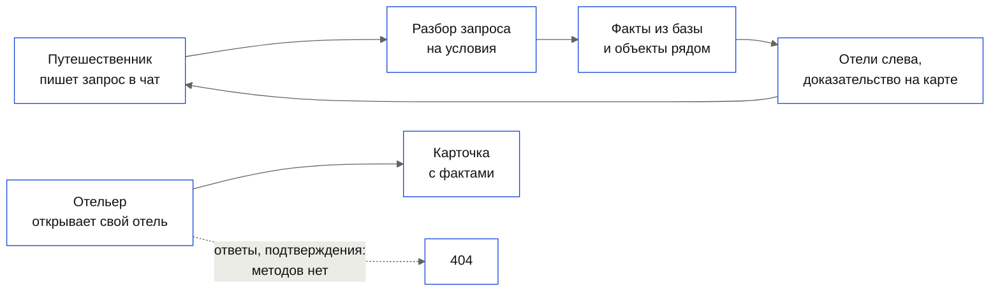
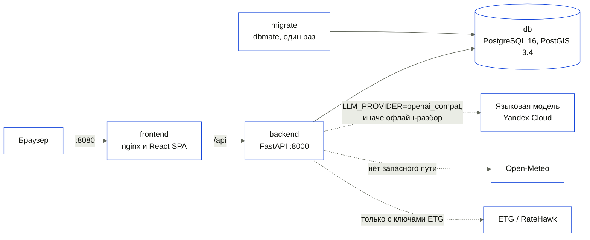
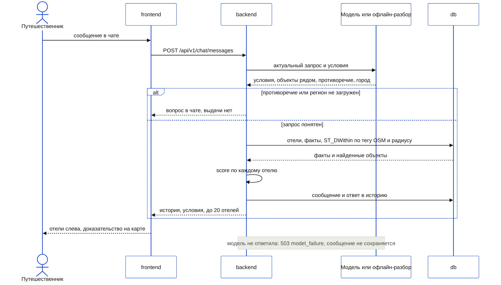

# Архитектура

> Factmap состоит из четырёх сервисов Compose: база PostgreSQL 16 с PostGIS 3.4, одноразовые
> миграции dbmate, бэкенд FastAPI и фронтенд React, который раздаёт nginx. Языковая модель только
> раскладывает текст запроса на условия; совпадение отеля с условием считает детерминированный код
> по фактам из базы и геопоиску PostGIS. Без ключей и без сети основной сценарий проходит на
> офлайн-разборе `LLM_PROVIDER=fake`, а карта, рельеф и демо-данные лежат в репозитории.

**Читайте, если** вы проверяете техническую проработку или добавляете код · **Связано:**
[API](api.md) · [зависимости](dependencies.md) · [запуск](running.md) ·
[объяснения решений](design-decisions.md)

---

## Кто что делает в системе?



| Роль | Что делает | Где проверяются права |
|---|---|---|
| Путешественник | Пишет запрос и уточнения в чат, выбирает отель, открывает доказательство условия на карте, выбирает даты для предложений | Нигде: входа нет, диалог открывается по UUID |
| Отельер | Видит карточку своего отеля с фактами и источниками; ответить, подтвердить или исправить факт не может, методов на бэкенде нет | Нигде: страница открывается по адресу |
| Система | Разбирает запрос, ищет объекты рядом, оценивает совпадение, рассчитывает факты из среза при `make precompute` | `backend/src/hotel_agent/domain/services/`, `application/use_cases/` |

Прав доступа нет ни на бэкенде, ни на фронтенде; это записано в
[ограничениях](limitations.md#нет-входа-и-прав-доступа).

## Из каких частей собран стенд?



| Контейнер | Образ | Роль |
|---|---|---|
| `db` | `imresamu/postgis:16-3.4` | Отели, здания, улицы, пешеходный граф, берег, пляжи, POI, факты, диалоги, связи с каталогом ETG; том `db-data` |
| `migrate` | `ghcr.io/amacneil/dbmate:2.36.0` | Применяет SQL из `backend/migrations/postgres/` и завершается; бэкенд стартует только после её успеха |
| `backend` | `python:3.12.15-slim`, зависимости ставит `uv` 0.11.33 | API и сценарии; проверка здоровья `GET /api/v1/health`; `characteristics/` и `data/` смонтированы только для чтения |
| `frontend` | `node:22-alpine` для сборки, `nginx:1.27-alpine` для раздачи | Раздача SPA и прокси `/api/` на `API_UPSTREAM` с таймаутом 120 с |

Все порты привязаны к `127.0.0.1`: 8080 фронтенд, 8000 бэкенд, 5432 база. Сессий и паролей
пользователей нет. Состояние живёт только в PostgreSQL: процесс бэкенда держит пул соединений и
загруженный реестр характеристик, история диалогов переживает перезапуск вместе с томом `db-data`.
Загрузка среза и расчёт фактов идут не через Compose, а командами `make seed` и `make precompute` с
хоста ([запуск](running.md)).

## Как проходит основной сценарий?



Ключевое решение принимает `score()` в `backend/src/hotel_agent/domain/services/scoring.py`: доля
выполненных условий, взвешенная по весу условия и уверенности факта. Факт берётся из базы, а для
объекта рядом создаётся в момент запроса из результата `ST_DWithin`
(`backend/src/hotel_agent/adapters/db/nearby_objects.py`). Если факта нет, совпадение
`unknown`: вес остаётся в знаменателе, отель опускается, но не исчезает. Обязательное условие
убирает отель только при подтверждённом несоответствии; отсутствие факта оставляет частичное
совпадение. Нарушение этих правил роняет тесты
`backend/tests/unit/domain/test_scoring.py`, например
`test_an_unknown_property_lowers_the_score_without_removing_the_hotel` и
`test_a_required_property_that_is_unknown_keeps_a_partial_recommendation`. Модель в этой точке ничего не
решает: условие с характеристикой не из реестра или со значением не того типа отбрасывается до
оценки (`test_an_invented_characteristic_is_dropped`,
`test_model_invents_no_unmentioned_or_wrongly_typed_intents`).

## Как устроен бэкенд?

```text
backend/
  src/hotel_agent/domain/        сущности, условия запроса, оценка, уверенность, конфликты источников
  src/hotel_agent/application/   сценарии в use_cases/ и порты в ports/
  src/hotel_agent/adapters/      PostgreSQL и PostGIS, модель, ETG, Open-Meteo, DEM, OSM, реестр YAML
  src/hotel_agent/interfaces/    роутеры и схемы FastAPI, команды CLI
  src/hotel_agent/composition.py выбор реализаций портов по настройкам
  src/hotel_agent/main.py        сборка приложения FastAPI
  migrations/postgres/           SQL-миграции dbmate
  tests/                         unit, contract, integration
```

| Слой | Что в нём | Чего ему нельзя |
|---|---|---|
| `domain` | `Fact`, `Intent`, `Characteristic`, `scoring`, `confidence`, `conflict_resolver` | Импортировать `application`, `adapters`, `interfaces` и `fastapi`, `pydantic`, `starlette`, `psycopg`, `yaml`, `httpx`, `anthropic`, `openai` |
| `application` | Сценарии (`SearchHotels`, `Chat`, `GetHotelOffers` и другие) и порты (`LLMPort`, `HotelOffersPort`, `WeatherPort`) | Импортировать `adapters`, `interfaces` и те же фреймворки |
| `adapters`, `interfaces` | Реализации портов, HTTP и CLI | Импортировать `main`, `composition`, `settings` |

Направление зависимостей проверяют `uv run lint-imports` по контрактам в `backend/pyproject.toml` и
независимо `backend/tests/unit/architecture/test_dependency_rule.py`. Почему слои лежат в
`backend/`, объясняет [ADR 0002](adr/0002-layers-inside-backend.md), почему SQL без ORM,
[ADR 0001](adr/0001-postgis-raw-sql.md).

## Как устроен фронтенд?

```text
frontend/src/
  app/        провайдеры, маршруты, оболочка, шапка, обработка ошибок
  pages/      экраны home, hotelier, compare, not-found: композиция фич
  features/   чат, результаты, карточка отеля, карта, факт, сравнение, ответ отельера, язык, тема
  entities/   данные и их отображение, запросы к API
  shared/     клиент API, примитивы интерфейса, словари RU и EN, токены
```

Импорты идут только вниз: `app → pages → features → entities → shared`; это проверяет правило
`scripts/checks/rules/code/layers.ts` в `npm run rules`. Типы API лежат в
`src/shared/api/schema.gen.ts` и генерируются из OpenAPI ([API](api.md#где-спецификация)). Тексты
интерфейса берутся только из словарей RU и EN, это проверяет `scripts/checks/rules/text/texts.ts`.
Карта построена на MapLibre GL: подложка, рельеф и 3D-здания приходят с бэкенда, положение солнца
считает `suncalc` в браузере.

## Что заменяется без правки сценариев?

| Порт | Реализация на стенде | Запасной путь | Как переключить |
|---|---|---|---|
| `LLMPort` | `OpenAICompatLLM`: DeepSeek V4.1 Flash через Yandex Cloud AI Studio | `FakeLLM`: фразы `matchers` из YAML реестра, без сети и ключа | `LLM_PROVIDER=fake` или `openai_compat` с `LLM_BASE_URL`, `LLM_API_KEY`, `LLM_MODEL` |
| `HotelOffersPort` | `EtgHotelOffers`: Hotelpage ETG/RateHawk | Порта нет, ответ `provider_unavailable` без цены | `ETG_KEY_ID` и `ETG_API_KEY` вместе, `ETG_ENVIRONMENT` |
| `CharacteristicRegistryPort` | `YamlCharacteristicRegistry` | Нет | `CHARACTERISTICS_DIR` |
| `WeatherPort` | `OpenMeteoWeather` | Нет: ответ `status: unavailable` | Не переключается |

Провайдер модели выбирается при старте, а не на каждый запрос: при сбое живой модели офлайн-разбор
в том же запросе не включается. Адаптер ждёт ответа `LLM_TIMEOUT_S` секунд (по умолчанию 30) и
один раз повторяет запрос после `ConnectError` или `ReadTimeout`; HTTP 429 и 5xx сразу дают
`503 model_failure`. Сообщение при этом не сохраняется, а интерфейс оставляет черновик в поле
ввода. ETG ждёт 12 секунд, после ошибки ответ `provider_error`, а не «мест нет». Open-Meteo ждёт
10 секунд, после ошибки `GET /api/v1/weather` отвечает `status: unavailable`. Рельеф и подложка карты
читаются из среза и базы и сети не требуют.

## Куда класть новый код?

| Что добавляется | Куда | Образец |
|---|---|---|
| Новая характеристика | `characteristics/<key>.yaml` | `characteristics/distance_to_sea.yaml` |
| Новое правило предметной области | `backend/src/hotel_agent/domain/services/` | `scoring.py` |
| Новый сценарий | `backend/src/hotel_agent/application/use_cases/` | `get_hotel_offers.py` |
| Новый внешний сервис | порт в `application/ports/`, адаптер в `adapters/external/`, выбор в `composition.py` | `hotel_offers.py` и `etg_offers.py` |
| Новый метод API | сначала `docs/api/openapi.yaml`, затем `backend/src/hotel_agent/interfaces/http/routers/` | `routers/hotels.py` |
| Изменение схемы базы | `backend/migrations/postgres/` | `20261025190000_hotel_supplier_refs.sql` |
| Новый экран | `frontend/src/pages/` | `pages/home/` |

---

<sub>[Оглавление документации](README.md) · [README проекта](../README.md)</sub>
