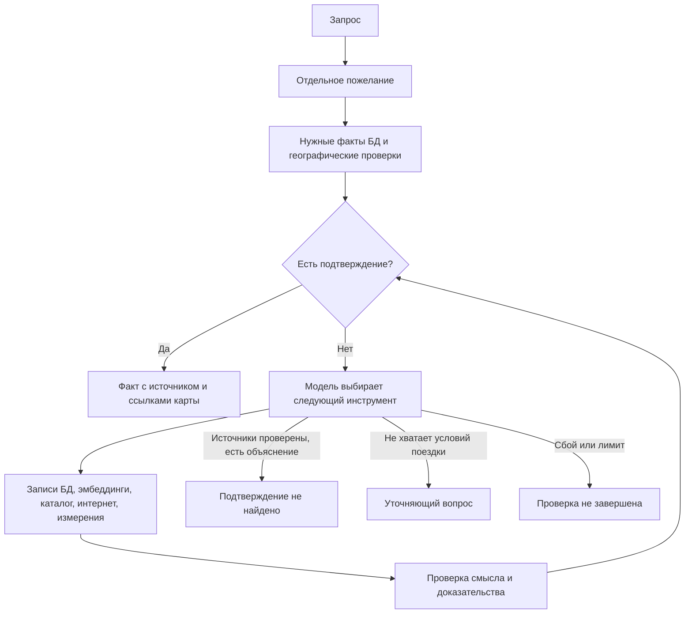

# Поиск по отдельным пожеланиям

После разбора запроса каждое пожелание получает собственный цикл исследования. Это относится
и к базовым условиям, и к произвольному описанию пользователя. Метка условия берётся из
запроса. Отдельного словаря «бары рядом» или перечня разрешённых желаний для этого нет.

Сначала `check_requested` читает только нужные факты выбранных отелей и выполняет запрошенные
географические проверки. Подтверждённое условие сразу попадает в результат. Если подтверждения
нет, модель выбирает следующий инструмент по наблюдениям и полному контексту запроса.
Отрицательный результат одной проверки оставляет возможность попробовать другой источник.

| Инструмент | Для чего используется |
|---|---|
| `inspect_data`, `list_candidates` | Узнать доступные поля, записи и идентификаторы отелей |
| `read_records` | Применить фильтры к фактическим полям; числовой фильтр дополнительно проверяется на соответствие пожеланию |
| `search_documents` | Найти близкие по смыслу фрагменты; сходство само по себе не становится фактом |
| `match_records` | Проверить смысл записи и получить дословную цитату без обязательной подстроки из запроса |
| `get_provider_content` | Прочитать описание отеля, услуги и категории номеров поставщика |
| `get_room_offers` | Получить предложения на указанные пользователем даты и состав гостей |
| `search_web`, `read_web_page` | Найти источник и проверить страницу с учётом названия, адреса и координат отеля |
| Географические инструменты, погода и солнце | Проверить условия по измерениям с подходящими единицами, датой и временем |

Если поставщик не настроен, не сопоставил отель, вернул ошибку или не дал категорий номеров,
`get_provider_content` пробует поиск в интернете по названию, городу и адресу. Результат
содержит ссылки для последующего чтения. Агенту требуется открыть страницу и проверить её
принадлежность отелю. Описание номера на сайте не подтверждает его доступность на даты.
При отключённом доступе к интернету результат сообщает об отсутствии этого источника.

`match_records` читает до 12 записей за шаг и возвращает следующий `offset`. Непрочитанные
страницы не считаются исчерпанными. Проверка текста принимает только известный идентификатор
записи и дословную цитату длиной не менее 12 символов из переданного фрагмента. Модель должна
подтвердить всё пожелание, включая отрицания, этаж и включение услуги в цену. Русский запрос
может подтверждаться описанием на другом языке. Качество смысловой проверки зависит от модели.

Для каждого пожелания сохраняется одно из состояний: подтверждено, проверенные источники
исчерпаны, нужно уточнение, проверка не завершена, источник недоступен. Завершение без
совпадения требует объяснения и проверки применимых источников. Повтор одинакового действия
не вызывает инструмент снова. После трёх повторов цикл сообщает о незавершённой проверке.
Несколько условий внутри одного пожелания соединяются по И. Вопрос по одному пожеланию
сохраняет отели, у которых подтверждены другие условия.

Предохранители: до 32 шагов модели и 180 секунд на пожелание, до 600 секунд на исследование пожеланий.
Срабатывание предохранителя не доказывает отсутствие свойства. Прокси допускает ответ до
900 секунд. Поиск синхронный; длительные исследования ещё не передают промежуточный прогресс
в интерфейс. Набор кандидатов ограничен 500 отелями, расширение около города — 50 км.
Один вызов каталога обрабатывает до четырёх отелей. Проверка текста использует фрагмент
до 2400 символов; сведения за его пределами могут потребовать другого документа или страницы.

Результаты подтверждений, причины неизвестности и географические ссылки сохраняются в БД
для карточек фактов. Журналы `wish_agent_step` и `wish_agent_finished` содержат пожелание,
действие, конечное состояние и число вызовов. [Проверки и пределы оценки](evidence.md#цикл-по-каждому-пожеланию-26-октября-2026).

## Смысловая проверка рекомендаций и ответа

После исследования `RecommendationReview` передаёт отдельному вызову модели исходный запрос,
сочетание найденных условий и доказательства по отелю. Проверяется область действия каждого
сведения: отель или окружение, конкретная категория номера, этаж, питание, даты, валюта и
единица цены. Свойства разных номеров нельзя объединять в обещание одного номера.
Модель видит исходные значения, цитаты, идентификаторы номеров, метод и срок действия факта.
Сам статус `matched` не считается доказательством.

Отклонённые кандидаты исключаются до сохранения фактов для выдачи. Проверка переходит
к следующим в ранжированном списке: до 60 отелей, пачками по 12. Подтверждение требует
единственного положительного вердикта с дословной цитатой из доказательств именно этого
кандидата. Пропущенный вердикт, чужая цитата и дублирование ID не дают разрешения на выдачу.
При пожеланиях без единого подтверждения случайные отели не предлагаются как подходящие.
Частичная выдача должна сохранять пометки неизвестных условий.

`ChatAnswerReview` проверяет готовый текст перед сохранением сообщения в историю. Число
отелей и обещания должны соответствовать проверенной выдаче, а уточнения должны касаться
действительно отсутствующих условий. Отклонённый текст заменяется коротким ответом о
составе подборки или невозможности подтвердить варианты. Спорные обещания и уточнения
из отклонённого текста в запасной ответ не переносятся.

Каждая проверка ограничена 30 секундами. Проверка кандидатов добавляет до 150 секунд,
проверка текста чата — до 30 секунд. Сбой модели сохраняется как недоступная проверка,
без утверждения об отсутствии подходящих отелей. В режиме `fake` проверяются только
известные типизированные подтверждения; произвольные тексты не получают автоматического
разрешения. Этот режим не оценивает качество смыслового суждения живой модели.

[Результаты локальной проверки](evidence.md#смысловая-проверка-ответа-26-октября-2026).
