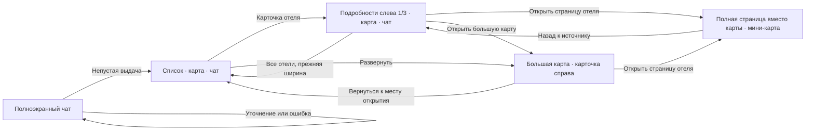

# Как сохранить одну логику при новых экранах и дизайнах

Статус: проектные решения к [спецификации](spec.md), 2026-10-27.
Имена новых модулей ниже предлагаемые. Они не означают, что файлы уже существуют.

## 1. Состояния разделяются по ответственности

| Слой состояния | Содержимое | Владелец |
|---|---|---|
| Данные диалога | messages, search, search_message_id, conversation_id | Существующие серверные ответы и TanStack Query |
| Навигация | Экран, list/details, выбранный отель, раздел, возврат и прежняя ширина списка | Один модуль переходов, связанный с router |
| Поисковый контекст | Выбранное свойство, geo_refs, сравнение | Существующий workspace с явными событиями |
| Карта | Камера, время, стиль, состояние готовности и качество | Постоянный основной экземпляр и его контроллер |
| Локальный интерфейс | Прокрутка, раскрытия, черновик, размеры панелей | Стабильные владельцы состояния, без копий server state |
| Проживание | Даты, гости, выбранная категория номера | Один контекст проживания для краткого и полного представлений |

`WorkspaceView = chat | hotels | map` сейчас означает вкладку узкого экрана.
Не расширять этот enum случайными `fullscreen`, `details`, `toy` и `rooms`:
тип экрана, вкладка, стиль и вложенный раздел независимы.

Предлагаемые состояния основного экрана:

| Экран | Основание входа | Что смонтировано/доступно |
|---|---|---|
| `conversation` | Нет принятой непустой выдачи и явного открытия отеля/карты | Полноэкранный чат |
| `workspace` | Принята выдача либо сохранён раскрытый диалог | Список, основная карта, чат |
| `map` | Явное раскрытие карты | Та же карта и необязательный краткий обзор |
| `hotel-panel` | Клик по карточке/маркеру обычной карты | Подробности слева на треть ширины; основная карта рядом, чат справа |
| `hotel-page` | «Открыть страницу отеля» либо `/hotels/:id` | Страница вместо карты; мини-карта внутри |

На диаграмме возврат из карты показан в список, со страницы — в панель. Фактическая цель берётся
из сохранённого origin: карта также возвращает в hotel-panel/hotel-page, страница — в map.
Выбранный маркер сам по себе не определяет источник перехода.

Дополнительные оси: `mobileTab`, `hotelSection`, `mapAppearance`, `uiTheme`, `sceneTime`.
Разделы отеля: `overview`, `room`, `fact`, `gallery`; `offers` в URL означает якорь раздела,
а не обязательную замену всего обзора. Карточка места остаётся отдельным подэкраном
географического контекста и не теряет обратный путь к отелю.

## 2. Какие события переводят экран

| Событие | Обновление | Что сохраняется |
|---|---|---|
| `sendMessage` | Только исходящее сообщение/ожидание | Экран, черновик до подтверждения отправки |
| `acceptSearch` с первыми results | `conversation → workspace` | Диалог, история, текущее поле ввода |
| `acceptClarification` без выдачи | `conversation → conversation` | Полноэкранный ввод |
| `acceptConsultation` со старым search_message_id | Экран не меняется | Выбранный отель, факт, маршрут |
| `selectHotel` | В workspace → hotel-panel; в большой карте — краткая карточка справа | Выдача, сравнение, диалог |
| `openHotelPanel` | `workspace → hotel-panel`, ширина панели 1/3 | Прежняя ширина списка, прокрутка и карта |
| `openHotelPage` | `hotel-panel/map → hotel-page`, вместо карты | Источник, ширины, прокрутка, диалог и карта |
| `expandMap` | `workspace/hotel-panel → map` | Основной MapLibre instance и источник возврата |
| `collapseMap` | `map → workspace/hotel-panel/hotel-page` по месту открытия | Камера, выбор, размеры панелей |
| `openLargeMapFromMini` | `hotel-panel/hotel-page → map` | Отель, маршрут, возврат к исходному представлению |
| `changeAppearance` | Только вид карты | Данные и навигация |
| `newConversation` | `→ conversation` | Настройки темы/стиля/языка; очищается старый поисковый контекст |
| `openConversation` | Загрузка через GET, затем вычисление экрана | Локальные настройки; старые данные не показаны как новые |
| `restoreLocation` | Декодирование и проверка URL | Восстановимый поисковый контекст без POST поиска |

Принимающий ответ проверяет ID диалога и актуальность запроса. Упорядочивание сообщений и правило
`search_message_id` сохраняются из существующего `use-hotel-workspace.ts`.
Переходы тестируются через публичные события и наблюдаемый результат, не по числу внутренних setState.

## 3. Канонические адреса и возврат

Предлагаемый формат нужно закрепить до написания экранов в E01:

| Состояние | Пример адреса |
|---|---|
| Новый диалог | `/` |
| Сохранённый диалог | `/?chat=<conversation_id>` |
| Расширенная левая панель отеля | `/?chat=<id>&hotel=<hotel_id>` |
| Большая карта | `/?chat=<id>&map=full&hotel=<hotel_id>` |
| Полная страница вместо центральной карты | `/hotels/<hotel_id>?chat=<id>&from=panel` |
| Полная страница вместо большой карты | `/hotels/<hotel_id>?chat=<id>&from=map` |
| Раздел предложений | Предыдущий адрес + `section=offers` |
| Явно выбранный вид карты в ссылке | Предыдущий адрес + `style=toy-town` или `style=neon` |

- `from=map` на полной странице задаёт её полный размер и резерв возврата в большую карту.
  `from=panel` означает центральную страницу и возврат в левую панель. Без from прямой вход
  показывает самостоятельную страницу с мини-картой и возвратом на главную. Разрешены только известные enum.
- Для возврата внутри сессии используется проверенный стек внутренних переходов; для прямого входа
  есть детерминированный резерв из URL. Не вызывать безусловный `history.back()`, уводящий с сайта.
- Ссылка на конкретную комнату/факт использует отдельный идентификатор только при открытом подходящем разделе.
  Неизвестные enum, недопустимые числа и чужие параметры не исполняются и безопасно нормализуются.
- Пользовательские переходы получают `push`; исправление/нормализация URL и движение камеры — `replace`.
  Панорамирование не создаёт сотни записей истории. Back/Forward не запускают LLM.
- Чат из URL загружается по ID из API, даже если его ещё нет в localStorage-истории.
  Нынешнее ограничение `open(id)` только известными history ID нужно адаптировать.
- Состояние камеры сохраняется в session history/state по диалогу. Для воспроизводимых ссылок можно
  добавить проверенные `lon/lat/z/bearing/pitch`; это не обязательное расширение первого этапа.
- Без сохранённой камеры использовать viewport ответа либо камеру отеля. Пустой кэш не означает новый поиск.
- Приоритет оформления: допустимый явный `style` в URL, затем сохранённый выбор, затем `neon`.
  Выбор пользователя обновляет настройку; простое чтение неизвестного URL её не повреждает.
- Смена языка, UI-темы и стиля не меняет экран и не сбрасывает черновик/даты.

Прямой вход в отель не требует поддельного `SearchResult`: идентификация, координаты и сцена
получаются из существующих карточки и scene. Совпадения с запросом отсутствуют честно.

## 4. Один основной экземпляр карты живёт дольше экранов

Существующий `useMapInstance` пересоздаёт карту при размонтировании владельца. Router и JSX нового
экрана должны сохранять этого владельца между workspace, hotel-panel, map и hotel-page.

Предлагаемая композиция:

1. Постоянная оболочка workspace размещается под `RootLayout` для `/` и `/hotels/:hotelId`.
2. Оболочка связывает сценарии через props/контекст с небольшим явным интерфейсом.
3. Основной `HotelMap` остаётся в одном DOM-контейнере; CSS меняет размещение или скрывает его.
4. Список и подробности занимают левый слот: меняются его содержимое и ширина, карта остаётся рядом.
   Полная страница — соседний слот центральной области, основная карта скрывается без размонтирования.
   Не переносить один контейнер между разными portal-родителями, если это приводит к remount React-дерева.
5. Перед скрытием останавливать камеру и фоновые анимации; при показе обновлять размер и восстанавливать
   текущую сохранённую камеру, а не последнюю камеру из поискового ответа.

`Map.resize()` обновляет размеры контейнера; порядок и доступность методов проверять по установленной
версии библиотеки. В проекте уже есть ResizeObserver: не добавлять второй конкурирующий механизм.
Официальная справка: [MapLibre Map](https://maplibre.org/maplibre-gl-js/docs/API/classes/Map/#resize).

### Бюджет экземпляров

| Режим | Основная карта | Мини-карта |
|---|---|---|
| Первый чат | Не создаётся | Не создаётся |
| Workspace / большая карта | Один видимый экземпляр | Не создаётся |
| Левая панель desktop | Один видимый, обновлён размер | Лениво, только в открытом видимом разделе расположения |
| Подробности mobile | Один скрытый, без активных эффектов, если уже создан | Один лёгкий при видимом разделе расположения |
| Полная страница после карты | Один скрытый, эффекты приостановлены | Один лёгкий в расположении |
| Прямая ссылка на полную страницу | Лениво при явном открытии большой карты | Один лёгкий в расположении |
| Выход из workspace/закрытие приложения | Освобождение instance, observers, workers | Освобождение |

Одновременно не более двух контекстов в описанном сценарии; скрытый основной не запускает цикл
рендера, запросы новых scene и сборку окон. Мини-карта освобождается при уходе со страницы отеля.
Если слабое устройство не выдерживает два контекста, резерв — лёгкая схема из тех же координат
и полученных контуров либо честный текстовый адрес с действием открытия основной карты.
Резерв не требует отдельного внешнего картографического сервиса.

## 5. Два оформления используют один модуль отрисовки

Существующие точки переноса:

- `shared/geo/basemap.ts`, `catalog-layers.ts`, `terrain.ts`, `time-tint.ts`;
- `features/hotel-map/use-hotel-map.ts`, `night-city/`, `texture/`, `quality/`;
- `shared/theme/use-map-colors.ts`, `shared/styles/tokens/map.css`;
- `entities/map-data/` для данных и версий, `markers/` для выбора и событий.

### Интерфейс оформления

Модуль оформления должен скрывать палитру, материалы, условную декоративную геометрию и эффекты.
Его внешний интерфейс не получает методы отправки чата, выбора тарифов или изменения фактов.

| Часть описания | Назначение |
|---|---|
| `id`, `labelKey`, `version` | Реестр, локализованное название, версия визуального пакета |
| `palette` | Семантические цвета земли, воды, объектов, подписей, маршрута и выбранного отеля |
| `classStyles` | Полное сопоставление классов каталога оформлению и нейтральный резерв |
| `materials` | Настройки объёмов и выбранного отеля; без бизнес-значений |
| `effects` | Декоративные окна/огни, разрешённые уровни качества |
| `mini` | Лёгкое представление этого же дизайна для мини-карты |

Предлагаемые методы контроллера: `applyAppearance(id)`, `updateScene(snapshot)`, `setVisible(value)`,
`dispose()`. Внутренние методы регистрации слоёв и worker-буферов не становятся публичным контрактом.
Камера и пользовательские действия остаются в общем контроллере карты.

Два настоящих варианта (`neon`, `toy-town`) оправдывают этот интерфейс. Третий вариант добавляется
описанием оформления, ресурсами и записью реестра; не копированием `HotelMap`, чата или маршрутов.
Для нетривиальной геометрии разрешён внутренний renderer-adapter оформления с обязательным освобождением
ресурсов. Стандартные объекты остаются обычными MapLibre-слоями, пока замер не докажет необходимость custom layer.

### Семантические роли слоёв

Фиксировать порядок ролей: подложка/рельеф → landcover → вода/берег → плоские здания/дороги →
объёмы → декоративные эффекты → геометрия фактов/маршруты → подписи/маркеры → DOM-управление.
Точные взаимные позиции дорог и контуров проверяются кадром; важнее отсутствие перекрытия зданий землёй.

Идентификаторы источников и географических объектов не зависят от дизайна. Каждый renderer знает
только принадлежащие ему слои и ресурсы. Смена дизайна не удаляет общий источник маршрута, кластеры,
открытый popover или feature-state выбранного объекта.

### Как переключать

Предпочтительный путь для этих двух дизайнов — обновление paint/layout и собственных декоративных слоёв
внутри существующей карты. Общие источники и обработчики остаются зарегистрированными.
Нельзя свести весь второй дизайн к смене двух цветов: материалы и характер объёмов тоже описаны в пакете.

Если для конкретного изменения необходим `setStyle`, исполнитель обязан восстановить принадлежащие
приложению источники, слои, изображения и выделение после готовности стиля. Сохранность custom layers
нельзя предполагать автоматически. Переход через diff не гарантирует сохранение всех ресурсов при
изменении glyphs/sprites. [Официальный контракт setStyle](https://maplibre.org/maplibre-gl-js/docs/API/classes/Map/#setstyle).

Последовательность применения:

1. Проверить ID и подготовить локальные ресурсы оформления.
2. Снять текущую камеру, выбор, видимую геометрию, время и качество.
3. Применить новый пакет только если он ещё соответствует последнему запросу пользователя.
4. Восстановить семантические слои и проверить их наличие/порядок.
5. Обновить DOM-маркеры, легенду и мини-карту тем же ID оформления.
6. Обозначить выбор применённым; освободить ненужные эффекты старого пакета.
7. При ошибке оставить/восстановить предыдущий рабочий пакет и доступное повторение.

Переход не пересобирает window mesh при изменении только цвета. Скрытые эффекты не продолжают работу
в worker. Запоздалый результат mesh помечается generation ID и не применяется к другому оформлению/отелю.

## 6. Уровни детализации исправляются отдельно от палитры

`source.minzoom`, `layer.minzoom` и фильтр SQL — разные ограничения. Изменение одного не создаёт
отсутствующую геометрию в другом. Это соответствует контрактам [источников](https://maplibre.org/maplibre-style-spec/sources/#vector)
и [слоёв MapLibre](https://maplibre.org/maplibre-style-spec/layers/#minzoom).

- Сохранить `/map/scene` для полных контуров на z16–19. Текущий контракт ограничивает bbox 4 км²,
  800 зданий и 100000 вершин; не повышать эти лимиты ради далёкого масштаба.
- Для z12–15 расширить серверные MVT-слои: геометрия в проекции метры, топологически безопасное
  упрощение, корректное обрезание, детерминированные id и классы.
- Для z10–12 выбирать обобщение или подготовленный слой кварталов по фактическим данным.
  Не запускать тяжёлый UNION всех зданий заново на каждый HTTP-запрос.
- Если нужен подготовленный уровень, добавить ограниченную таблицу/материализованный набор,
  SQL-миграцию, индекс и явную команду пересборки для региона. Не вводить это до замера E03.
- Обобщение учитывает экранный размер геометрии, а не случайное удаление каждого второго дома.
- `building_id` в тайлах и scene должен обозначать один исходный объект; это нужно для исключения
  двойных объёмов и непрерывного выделения. Сейчас SQL MVT не выводит этот идентификатор явно.
- Высоты, источник высоты и признак условности не смешиваются. Декоративная высота не записывается в facts.
- Выбранный отель и связанные геообъекты не исчезают при бюджетном ограничении фоновой сцены.
- Низкое качество отключает окна/свечение/объёмы, но оставляет плоские контуры и активный маршрут.

Версия данных (`tiles_version`) отличается от версии оформления. Изменение цвета не меняет URL данных;
изменение MVT требует смены data-version и согласованного кэша. Проверить фактическую поддержку `v`:
сейчас scene использует версию, а `basemap.ts` собирает URL MVT константой.
При добавлении version query сначала обновить OpenAPI, серверную обработку и cache key, затем клиент.
Нельзя помещать новые байты под старый URL с immutable cache.

## 7. Общие блоки отеля не теряют данные

Карточка списка, правая карточка большой карты, левая панель и полная страница используют общие queries по ID, один контекст проживания,
общие блоки совпадений, удобств, фактов, комнат и предложений. Они не копируют DTO в локальные модели,
которые теряют provenance, nullable или статус частичного ответа.

- Карточка списка: реальное фото, название, категория, адрес, цена «от» и только найденные пожелания.
- `HotelHero` подробностей: компактная идентификация; пожелания раньше большой галереи и формы тарифов.
- `MatchRows`: в списке фильтр подтверждённых совпадений; в подробностях полный разбор с ограничениями.
  Общий формат значения + условие + статус + действия карты/доказательства.
- `HotelFacilities`: сводка и раскрытие; объединение только по проверенным идентификаторам.
- `FactList`: краткие значения; подробный provenance остаётся в `FactDetails`.
- `HotelOffers` / `RoomCatalog` / поля проживания: в подробностях сразу после пожеланий.
  «Номера и цены» прокручивает к разделу; конкретная комната открывается во вложенном состоянии.
- Форматирование `pets_policy`: локализованные allowed/вес/доплата; отсутствие поля не равно нулю.
- В конфликте фактической высоты и геометрии не выдавать оформление 3D за подтверждённое измерение.

Изменение выбора не сбрасывает введённые даты. Различные отели могут иметь отдельное выбранное room ID,
но общие даты/гости. При новом запросе, явно меняющем даты, пересчитываются только зависимые предложения.
Отправка ответа/confirm/correct продолжает инвалидировать вопросы, hotel, fact, compare и связанные
результаты через существующие ключи. В обеих композициях данные должны обновиться одинаково.

### Ширина левой панели принадлежит навигации

На входе `list → details` сохранить измеренную ширину списка, scrollTop и ID карточки для фокуса.
Ширина details на desktop — треть рабочей области, с учётом существующих gaps. На обратном переходе
восстановить сохранённую ширину, ограниченную текущим viewport после resize окна. Повторное открытие
другого отеля не перезаписывает прежнюю ширину списка шириной details. При переходе на полную страницу
слева снова список прежней ширины, в центре содержимое отеля; snapshot возврата всё ещё хранит details 1/3.
Back возвращает расширенную панель и карту, а следующий «Все отели» — исходный список.

Анимация размеров использует существующие motion-примитивы и один ResizeObserver карты. Не измерять
layout каждой строки на каждом кадре. reduced motion сразу применяет конечную раскладку.
Сохранение камеры не запрещает минимальную коррекцию для видимости выбранного маркера, если он
оказался закрыт интерфейсом; повторный fit всей выдачи и пролёт из старого search viewport запрещены.

### Изображения, категория и цена имеют независимые источники

В E00/E12 составить отображение DTO → фото/звёзды/адрес/цена/совпадения. Если категория не приходит,
сначала проверить профиль и контракт поставщика, затем описать перенос реального поля. Нельзя выводить
звёзды из типа здания, названия или match-score. Для фотографий нужны URL, принадлежность отелю/номеру
и доступное описание; отсутствие связи с номером не даёт права подписать «вид из этого номера».

Цена «от» вычисляется только среди сопоставимых offers. Query key включает отель, даты, гостей и другие
реальные параметры запроса. Изменение стиля карты не инвалидирует этот кэш. Фоновая загрузка карточек
ограничивается видимой областью и небольшим пулом; устаревший период не подставляется под новые даты.
Точный размер пула и бюджет запросов фиксируются в E12 до замера. Ошибка цены не блокирует выбор отеля.

## 8. Покрытие существующего API

Инвентарь извлечён из `docs/api/openapi.yaml` SHA `63bef5f`: **26 method/path операций**.
Это число относится к файлу контракта; полная runtime-сверка предусмотрена E00/E13.
Префикс всех путей ниже — `/api/v1`. Для новой раскладки операции не нужны; постоянное отложение
вопроса из R6 требует отдельного расширения H02, описанного ниже.

| Операции | Потребитель и обязательная регрессия |
|---|---|
| GET `/health` | Доступность API и честная ошибка |
| GET `/regions`, GET `/characteristics` | Географический контекст, подписи и правила фактов |
| POST `/search`, POST `/chat/messages` | Поиск/диалог; оформление и Back не вызывают их повторно |
| GET/PATCH/DELETE `/chat/conversations/{conversation_id}` | Восстановление, переименование, удаление |
| GET `/hotels/{hotel_id}` | Обе карточки, прямая ссылка, nullable/пустые поля |
| GET `/hotels/{hotel_id}/offers` | Даты/гости; тарифы, partial, sandbox, no_offers и ошибки |
| GET `/hotels/{hotel_id}/scene` | Выбранный отель, камеры, реальные геометрии |
| GET `/hotels/{hotel_id}/facts/{fact_id}` | Полный факт, provenance, история, конфликт |
| POST `/geo-features:batch` | Подсветка/маршрут; не меняется при смене дизайна |
| GET `/map/catalog`, GET `/map/style` | Классы, манифесты и версии ресурсов |
| GET `/map/scene` | Ограниченная детальная сцена, 409 версии, лимиты |
| GET `/map/tiles/{z}/{x}/{y}.pbf` | Дальняя застройка, декодируемые слои, cache version |
| GET `/map/terrain/{z}/{x}/{y}.png`, GET `/map/relief/{z}/{x}/{y}.png` | Рельеф и подложка в обоих дизайнах |
| GET `/weather` | Та же погода для тех же координат/даты; не привязана к оформлению |
| POST `/compare` | Те же выбранные ID и значения |
| GET `/places/{place_id}` | Место, маршрут, часы работы и возвращение к отелю |
| GET `/hotelier/{hotel_id}/questions` | Открытые/отвеченные вопросы и пустое состояние |
| POST `/hotelier/questions/{question_id}/answer` | Сохранение факта, уточнение, конфликт, cache invalidation |
| POST `/facts/{fact_id}/confirm`, POST `/facts/{fact_id}/correct` | Статус, версия факта, история и обновление карточек |

Бинарные MVT/PNG проверяются декодированием и заголовками, JSON — схемой, DELETE 204 не читается как JSON.
Формы `false`, `0`, `null`, отсутствующее поле и пустой массив сохраняют разные значения.
Карточка не приписывает достоверность отсутствующему полю из-за неявного значения по умолчанию.

Картографические расширения после E03: версия MVT, явно описанные поля идентичности/LOD, опциональные
сведения о покрытии в манифесте. Сначала контракт и сервер, затем генерация типов, затем потребители.
Answer/confirm/correct уже существуют; их повторный перенос не нужен. Для R6 добавить PATCH статуса
вопроса и поля сохранённого ответа в GET по [контракту H02](hotelier.md#6-для-отложения-и-сохранённого-ответа-нужен-конкретный-контракт).
Это одно новое действие, а не обещание, что enum skipped уже даёт работающую кнопку.

## 9. Размещение кода и владельцы файлов

| Ответственность | Существующая точка | Возможное выделение |
|---|---|---|
| Состояние диалога и выдачи | `features/hotel-search/` | События поискового контекста без JSX страницы |
| URL и переходы | `app/router.tsx`, `pages/home/` | `features/workspace-navigation/` |
| Постоянная оболочка | `app/root-layout/`, `pages/home/` | Отдельный workspace layout в `app/` |
| Подробная левая панель и полная страница | `pages/home/selected-hotel.tsx` | `pages/hotel/`, общие блоки в двух слотах |
| Список, подробности и offers | `features/hotel-details/`, текущая карточка списка | Общие данные/форматтеры, разные композиции |
| MapLibre lifetime | `features/hotel-map/use-map-instance.ts` | Тот же владелец с явной видимостью |
| Пакеты оформления | `shared/geo/`, `shared/theme/` | `shared/geo/map-appearance/` с небольшим реестром |
| LOD и SQL | `adapters/db/map_tiles.py` | Именованные модули LOD, если SQL перерастёт лимит |

Порядок зависимостей FSD сохраняется: страницы связывают features; соседние features не импортируют
друг друга. Контроллер оформления не знает страниц. Backend использует существующие порты/UoW.
Файлы кода не превышают 250 строк, каталоги не превращаются в свалку всех вариантов карты.

Работа по этому плану последовательная. Если позже явно разрешат параллельное выполнение,
оболочка, OpenAPI, tokens и реестр оформлений должны иметь по одному владельцу; каждый исполнитель
работает в отдельном worktree с согласованными контрактами. Сам план не запускает параллельных агентов.

## 10. Кабинет использует те же факты, но отдельное состояние работы

Серверные questions/facts остаются в entities/TanStack Query. Модуль сессии отельера владеет выбором,
черновиками по hotel/question/fact ID, результатами запросов и восстановлением после перехода.
Страница компонует очередь, форму, сведения о факте и отдельный туристический предпросмотр.
Соседние features связываются через страницу и общие entities, не импортируют друг друга циклически.

Новые состояния описаны в [R6](hotelier.md): idle/editing/submitting/saved/follow_up/error;
статус open/skipped/answered принадлежит серверу. UI не меняет его окончательно до ответа.
Дедупликация мутаций по сущности действует на обработчике и на всей группе кнопок; backend сохраняет
свои блокировки. Нельзя рассчитывать только на disabled у одной кнопки.

Изменения API H02 идут через существующие domain/usecase/port/adapter/controller и composition root.
Общие форматтеры значений и выбор актуальной версии факта обслуживают и R5, и R6. Внешний дизайн
туристической карточки не определяет поля рабочей формы отельера.
